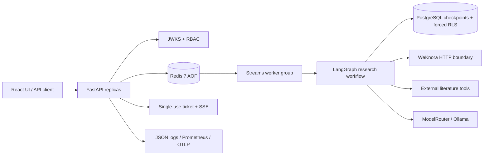

# Production Knowledge Agent

A portfolio-grade, tenant-aware research agent built around FastAPI,
LangGraph, PostgreSQL and Redis. It combines grounded internal retrieval with
optional literature discovery, runs work through a durable at-least-once queue,
and makes its security and production boundaries explicit.

## What is implemented

- Grounded research graph with internal WeKnora retrieval, optional
  arXiv/GitHub/CrossRef/Springer metadata, citation validation and approval.
- Durable task records, tenant-scoped idempotency, Redis Streams workers,
  heartbeat leases, bounded retries, crash takeover and cross-replica cancel.
- Production JWKS authentication with rotation, RBAC, single-use SSE tickets,
  shared rate limiting and PostgreSQL forced row-level security.
- Prompt-injection defense in depth: untrusted JSONL evidence, control-token
  neutralization, detection events, static tool routing and strict citation
  gating.
- Correlated JSON logs, credential redaction, Prometheus metrics and
  cross-replica OpenTelemetry trace propagation.
- React/Vite operator UI, browser E2E coverage, Docker packaging and repeatable
  deployment verification.

## Architecture



Redis is the durable control plane and delivery layer; PostgreSQL stores graph
checkpoints; WeKnora owns knowledge data behind HTTP. PDFs and full documents
do not enter LangGraph state.

## Quick start

Requires Python 3.12 and `uv`. Node.js 20.19+ is required for the UI.

```bash
uv sync --frozen
uv run uvicorn pk_agent.agentos.main:app --reload
```

The default development runtime uses in-memory task/checkpoint state. Open
`http://localhost:8000` and use a token such as
`dev:tenant-a:user-a:admin`.

Frontend development:

```bash
cd frontend
npm ci
npm run dev
```

Core container deployment:

```bash
docker compose up -d --build db redis app
bash scripts/verify_core_deployment.sh
```

The full Compose file also contains the isolated WeKnora subsystem. Its local
source/build context is expected at `../WeKnora`; see
[WeKnora operations](docs/runbooks/weknora-ops.md).

## Production configuration

Production startup fails closed unless Redis runtime and asymmetric identity
configuration are present:

```text
PK_AGENT_ENVIRONMENT=production
PK_AGENT_RUNTIME_STORE=redis
PK_AGENT_JWT_JWKS_URL=https://identity.example.com/.well-known/jwks.json
PK_AGENT_JWT_ISSUER=https://identity.example.com/
PK_AGENT_JWT_AUDIENCE=production-knowledge-agent
```

Set scoped provider credentials through environment/secret injection. Never
commit `.env`. Put `/metrics` on an internal network or protect it at ingress.
See [.env.example](.env.example) for all runtime, worker, provider and
observability settings.

## Verification

```bash
make quality              # ruff, mypy, pytest
make e2e                  # production UI build + Chromium E2E
make verify-deployment    # live API, Redis Streams, PostgreSQL RLS, metrics
```

Current automated evidence:

| Gate | Result |
|---|---|
| Python tests | 103 passed |
| Ruff | passed |
| mypy | passed, 51 source files |
| Frontend production build | passed |
| Chromium E2E | 1 passed |
| npm audit | 0 vulnerabilities |

Deployment evidence is intentionally distinct from mocked tests. The verifier
checks a real task, cross-tenant 404 behavior, Redis consumer group state,
forced PostgreSQL RLS with and without tenant context, and Prometheus output.

## API surface

- `GET /health`
- `GET /metrics`
- `GET/POST /api/v1/tasks`
- `GET/DELETE /api/v1/tasks/{task_id}`
- `POST /api/v1/tasks/{task_id}/resume`
- `POST /api/v1/tasks/{task_id}/events/ticket`
- `GET /api/v1/tasks/{task_id}/events?ticket=...`
- `POST /api/v1/literature/search`

Task inputs support approval, external-search and explicit external-PDF-ingest
flags. External writes remain risk-gated and must define their own idempotency
contract because job delivery is at least once.

## Production boundaries

- Redis AOF improves durability but does not provide exactly-once side effects.
- Prompt injection cannot be solved by text filtering alone; capability
  separation and output validation are the primary controls.
- JWKS, PostgreSQL RLS, Redis and container behavior must be exercised in the
  target deployment, not inferred from unit tests.
- WeKnora data isolation depends on scoped API keys and explicit tenant-to-KB
  mapping; business code never connects to its database.

## Documentation

- [Threat model](docs/threat_model.md)
- [Compatibility matrix](docs/compatibility-matrix.md)
- [Production readiness checklist](docs/production-readiness.md)
- [Architecture decisions](docs/adr/)
- [Build reports](docs/build-reports/)
- [Operations runbooks](docs/runbooks/)

