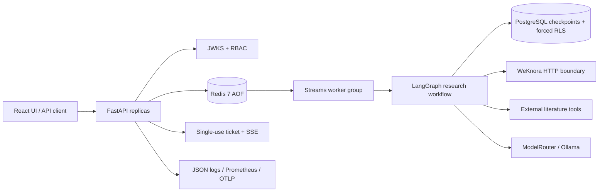

# Production Knowledge Agent(科研副驾驶)

一个作品集级别的多租户研究 agent,基于 FastAPI、LangGraph、PostgreSQL 与
Redis 构建。它将"有据可依"的内部检索与可选的外部文献发现结合起来,任务经由
持久化的至少一次(at-least-once)队列执行,并显式声明自身的安全与生产边界。

## 已实现的能力

- 有据可依的研究图:内部 WeKnora 检索、可选的 arXiv/GitHub/CrossRef/Springer
  元数据检索、引用校验(citation gate)与人工审批。
- 模型块系统:LLM 自主规划并调用预注册的数值模拟块(sklearn_tabular /
  torch_mlp / kv_cache_sim),经 Redis broker 在 GPU executor 容器中执行,
  产物存入 MinIO 并可鉴权下载。
- Skill 系统:从已完成任务蒸馏可复用流程(候选 → 离线确定性评估 → 人工审批),
  审批通过后由确定性匹配注入后续回答的 prompt;多副本经 Redis pub/sub 同步刷新。
- 持久化任务记录、租户级幂等、Redis Streams worker、心跳租约、有界重试、
  崩溃接管与跨副本取消。
- 生产级 JWKS 认证(支持密钥轮换)、RBAC、一次性 SSE ticket、共享限流、
  PostgreSQL 强制行级安全(RLS)。
- 纵深提示注入防御:不可信 JSONL 证据、控制符中和、注入检测事件、静态工具
  路由与严格引用门。
- 关联 JSON 日志、凭据脱敏、Prometheus 指标与跨副本 OpenTelemetry 链路传播。
- React/Vite 中文操作界面、浏览器 E2E 覆盖、Docker 打包与可重复的部署验证。

## 架构



Redis 是持久的控制面与投递层;PostgreSQL 保存图 checkpoint;WeKnora 在 HTTP
边界之后独立持有知识数据。PDF 与完整文档不会进入 LangGraph state。

## 快速开始

需要 Python 3.12 与 `uv`;前端界面需要 Node.js 20.19+。

```bash
uv sync --frozen
uv run uvicorn pk_agent.agentos.main:app --reload
```

默认开发运行时使用内存态任务/checkpoint 存储。打开
`http://localhost:8000`,使用形如 `dev:tenant-a:user-a:admin` 的开发令牌登录。

前端开发:

```bash
cd frontend
npm ci
npm run dev
```

核心容器化部署:

```bash
docker compose up -d --build db redis app
bash scripts/verify_core_deployment.sh
```

完整的 Compose 文件还包含隔离的 WeKnora 子系统,其本地源码/构建上下文预期位于
`../WeKnora`;首次接入 WeKnora 时运行 `python scripts/init_weknora.py`
(幂等)获取 API key 与知识库 id,写入项目根 `.env`(已被 gitignore)。
详见 [WeKnora 运维手册](docs/runbooks/weknora-ops.md)。

## 生产配置

生产模式启动是"失败即关闭"的:缺少 Redis 运行时与非对称身份配置时直接拒绝启动:

```text
PK_AGENT_ENVIRONMENT=production
PK_AGENT_RUNTIME_STORE=redis
PK_AGENT_JWT_JWKS_URL=https://identity.example.com/.well-known/jwks.json
PK_AGENT_JWT_ISSUER=https://identity.example.com/
PK_AGENT_JWT_AUDIENCE=production-knowledge-agent
```

各类 provider 凭据通过环境变量/secret 注入,按最小权限配置。绝不要提交
`.env`。`/metrics` 应放在内网或在入口层加保护。全部运行时、worker、provider
与可观测性配置见 [.env.example](.env.example)。

## 验证

```bash
make quality              # ruff、mypy、pytest
make e2e                  # 生产构建前端 + Chromium E2E
make verify-deployment    # 真实 API、Redis Streams、PostgreSQL RLS、指标
```

当前自动化验证证据:

| 关卡 | 结果 |
|---|---|
| Python 测试 | 163 passed,1 skipped(本地 torch) |
| Ruff | 通过 |
| mypy | 通过,73 个源文件 |
| 前端生产构建 | 通过 |
| Chromium E2E | 1 passed |
| npm audit | 0 漏洞 |

部署证据刻意与 mock 测试区分开:部署验证器检查真实任务、跨租户 404 行为、
Redis 消费者组状态、有无租户上下文两种情况下 PostgreSQL 的强制 RLS,以及
Prometheus 输出。`scripts/` 下另有针对文献、模型块、技能与 WeKnora 的
真实链路 smoke 脚本。

## API 面

- `GET /health`
- `GET /metrics`
- `GET/POST /api/v1/tasks`
- `GET/DELETE /api/v1/tasks/{task_id}`
- `POST /api/v1/tasks/{task_id}/resume`
- `POST /api/v1/tasks/{task_id}/events/ticket`
- `GET /api/v1/tasks/{task_id}/events?ticket=...`
- `POST /api/v1/literature/search`
- `GET/POST /api/v1/modelblocks`、`GET /api/v1/artifacts/{id}`
- `GET /api/v1/skills`、`GET /api/v1/skills/pipeline`
- `POST /api/v1/skills/distill`、`POST /api/v1/skills/{id}/{ver}/evaluate|approve|deprecate`

任务输入支持审批、外部检索与显式的外部 PDF 灌库开关。外部写操作始终受风险
门控;由于任务投递是至少一次语义,外部写必须自行定义幂等契约。

## 生产边界

- Redis AOF 提升持久性,但不提供精确一次(exactly-once)的副作用保证。
- 提示注入无法仅靠文本过滤解决;能力隔离与输出校验才是主要防线。
- JWKS、PostgreSQL RLS、Redis 与容器行为必须在目标部署环境中实测,不能从
  单元测试推断。
- WeKnora 的数据隔离依赖按租户发放的 API key 与显式的租户-知识库映射;
  业务代码永远不直连它的数据库。

## 文档

- [威胁模型](docs/threat_model.md)
- [兼容性矩阵](docs/compatibility-matrix.md)
- [生产就绪清单](docs/production-readiness.md)
- [架构决策记录](docs/adr/)
- [构建报告](docs/build-reports/)
- [运维手册](docs/runbooks/)
